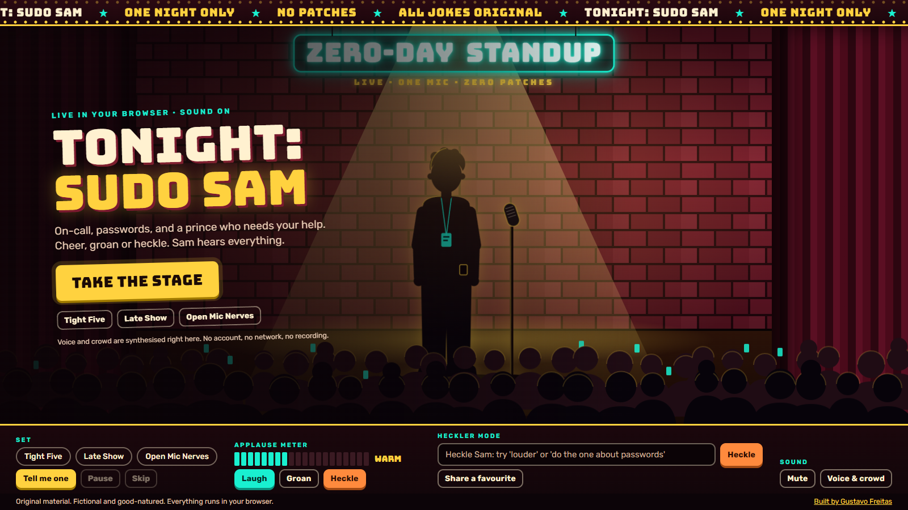
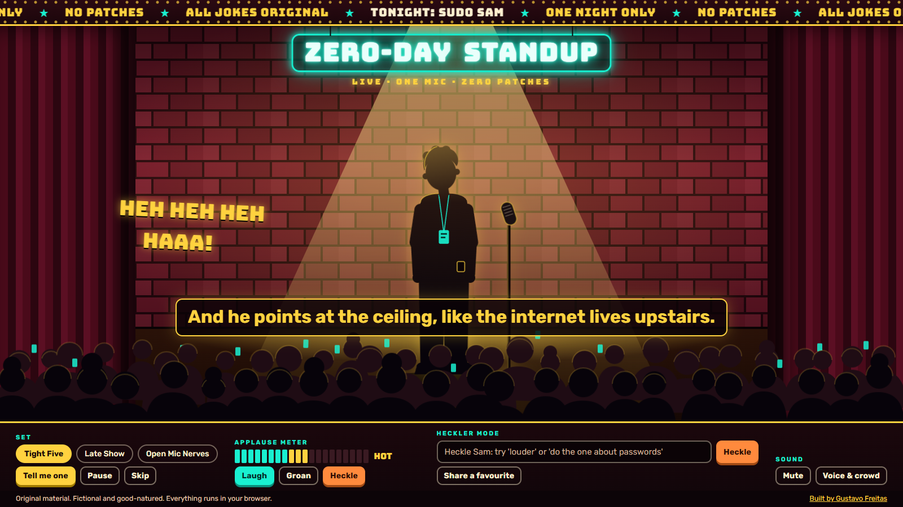

# ZERO-DAY STANDUP

A one-night-only comedy club in your browser: Sudo Sam does original on-call, password and phishing-prince stand-up, and the crowd talks back.

**[Live demo](https://tootenramen.github.io/Zero-Day-Standup/)**

## What you can do
- Take the stage and watch three original sets (Tight Five, Late Show, Open Mic Nerves), 30 jokes, shuffled every run.
- Cheer, groan or heckle: the applause meter moves and Sam answers with a pre-written reply.
- Heckler mode: type anything ("louder", "do the one about passwords", "AI") and get a good-natured comeback. Ask for a topic and Sam performs the matching joke.
- Hit "Tell me one" for an instant joke, "Encore" at the end, or "Share a favourite" to copy a joke.
- Pick the voice, speed and pitch, set the crowd volume, or mute and just read the captions.

## How it works
- 100% client-side. No network calls, no accounts, nothing leaves your browser.
- Sam's voice is the browser's built-in speech synthesis. A delivery engine chunks each line by sentence, times the pause before every punchline, lifts rate and pitch on the punch, and works around the Chrome/Edge long-utterance cutoff.
- The crowd (laughter, applause, "ooh", rimshot, crickets) is synthesised with WebAudio. Crowd mood changes the pacing and which tags Sam picks. Audio only starts after you click.
- The stage and comedian are plain SVG and CSS. Reduced-motion is respected.

## Skills this shows
Front-end craft without frameworks, WebAudio and Web Speech APIs, a small rules engine with unit-testable timing and matcher logic, accessibility and responsive design.

Built by Gustavo Freitas - [LinkedIn](https://www.linkedin.com/in/gustavo-freitas-69b93910b/) - [more projects](https://github.com/Tootenramen)
